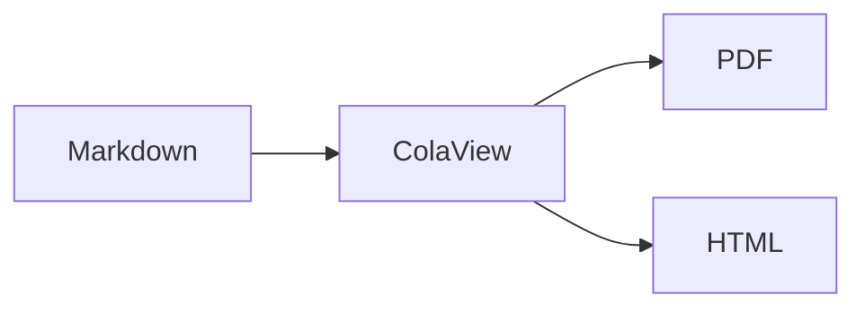

# ColaView MD

[](https://code.visualstudio.com/)
[](https://www.typescriptlang.org/)
[](LICENSE)
[](package.json)

Rich Markdown preview & PDF/HTML/Word export for VS Code — powered by [ColaMD](https://github.com/byteuser1977/ColaMD-extend) rendering engine (CodeMirror 6 based).

## Features

- **WYSIWYG Preview** — CodeMirror 6 powered read-only editor renders Markdown as rich text in real-time, with source buffer as the single source of truth
- **Math Formulas** — KaTeX integration for inline `$...$` and display `$$...$$` expressions (fonts inlined via base64)
- **Mermaid Diagrams** — 17+ chart types: flowcharts, sequence, class, state, ER, Gantt, mind maps, etc.
- **PDF Export** — Puppeteer headless Chrome renders A4 PDF with full theme styling
- **HTML Export** — Standalone `.html` with embedded CSS and fonts, zero-dependency sharing
- **Word Export** — High-fidelity `.docx` with headings, lists, tables, images, code blocks, footnotes, and rasterized KaTeX/Mermaid
- **Theme-Faithful Export** — PDF/HTML/Word exports inherit the current preview theme's fonts, accent colors, table styling and blockquote padding
- **12 Built-in Themes** — Light, Dark, Elegant, Sepia, Notion, Bear, Writer, Solarized Dark, Nord, Gruvbox, Dracula, Midnight
- **Custom Theme Directory** — Drop `.css` files into `.themes/` folder in your workspace root; they appear automatically in the theme menu
- **Right-click Context Menu** — Export HTML/PDF, switch theme (with submenu), import custom theme — all from within the preview panel
- **Live Sync** — 150ms debounced update while editing, experimental scroll sync between editor and preview
- **Source Buffer Fidelity** — Raw Markdown bytes are preserved exactly; export uses the buffer content directly, no serialization loss

## Quick Start

1. Install the extension
2. Open a `.md` file in VS Code
3. `Ctrl+Shift+P` → **"ColaView MD: Show Preview"**
4. Preview opens in a side panel with rich rendering

## Commands & Usage

### Command Palette (`Ctrl+Shift+P`)

| Command | Description |
|---------|-------------|
| `ColaView MD: Show Preview` | Open or focus the preview panel |
| `ColaView MD: Export to PDF...` | Export current file as A4 PDF |
| `ColaView MD: Export to HTML...` | Export as standalone HTML |
| `ColaView MD: Export to Word...` | Export current file as `.docx` Word document |
| `ColaView MD: Switch Preview Theme...` | Choose from 12 built-in + custom themes |
| `ColaView MD: Import Custom Theme...` | Load a `.css` file as custom theme |

### Right-click Context Menu (in Preview)

When the preview is open, right-click anywhere to access:

| Menu Item | Description |
|-----------|-------------|
| **Export HTML** | Export current preview as standalone HTML |
| **Export PDF** | Export current preview as A4 PDF |
| **Export Word** | Export current preview as `.docx` Word document |
| **Theme ▸** | Submenu listing all built-in + custom themes (✓ marks active) |
| **Import Theme...** | Open file picker to import a `.css` file |

## Themes

### Built-in Themes

| Theme | Style | Best For |
|-------|-------|----------|
| **Light** | Clean white, blue accents | General use, documentation |
| **Dark** | GitHub Dark palette | Night coding |
| **Elegant** | Warm serif, beige tones | Academic papers, long-form |
| **Sepia** | Warm sepia, paper texture | Extended reading, low-eye-strain |
| **Notion** | Not.so MCP | Notion-like clean minimalism |
| **Bear** | Bear.app style | Note-taking, casual writing |
| **Writer** | Monospace-friendly | Technical writing, code-heavy docs |
| **Solarized Dark** | Ethan Schoonover palette | Low-contrast dark coding |
| **Nord** | Arctic blue palette | Calm, focused writing |
| **Gruvbox** | Retro 80s terminal | Nostalgia, high-contrast |
| **Dracula** | Zeno Rocha palette | Vibrant dark theme |
| **Midnight** | Deep navy, gold accents | Night writing, premium feel |

### Custom Themes

Place `.css` files in the `.themes/` directory at your workspace root. Two custom themes are bundled with the extension:

| Theme | Style | Best For |
|-------|-------|----------|
| **Academic Paper** | GB/T 7713 standard, serif body, three-line tables, black-on-white | Academic papers, formal documents, printing |
| **Trae Blue** | Trae IDE documentation style, white + Slate gray, blue accents | Technical docs, modern documentation |

```
my-project/
├── .themes/
│   ├── my-dark.css        # appears as "My-dark" in theme menu
│   └── corporate.css      # appears as "Corporate" in theme menu
└── README.md
```

Custom themes are automatically detected and appear alongside built-in themes in both the command palette and right-click context menu.

Switch via command palette or settings:

```json
{ "colaview.theme": "nord" }
```

Import custom CSS: `Ctrl+Shift+P` → "ColaView MD: Import Custom Theme..." or via right-click menu → "Import Theme..."

## Configuration

| Setting | Type | Default | Description |
|---------|------|---------|-------------|
| `colaview.theme` | `string` | `"elegant"` | Preview theme: `light`, `dark`, `elegant`, `sepia`, `notion`, `bear`, `writer`, `solarized-dark`, `nord`, `gruvbox`, `dracula`, `midnight`, or any custom theme name |
| `colaview.plugins.math` | `boolean` | `true` | *(Deprecated, always-on since v0.3.0)* KaTeX is built into the ColaMD engine and cannot be disabled |
| `colaview.plugins.mermaid` | `boolean` | `true` | *(Deprecated, always-on since v0.3.0)* Mermaid is built into the ColaMD engine and cannot be disabled |
| `colaview.pdfMethod` | `string` | `"puppeteer"` | PDF engine: `puppeteer` or `webviewPrint` |
| `colaview.autoPreview` | `boolean` | `false` | Auto-open preview for `.md` files |
| `colaview.customThemesPath` | `string` | `""` | Directory for custom theme CSS files |
| `colaview.scrollSync` | `boolean` | `false` | **Experimental** — Enable scroll sync between editor and preview |

> **Note on plugin settings:** Since v0.3.0, math and mermaid rendering are integral parts of the CodeMirror 6 based ColaMD engine and are always enabled. The `colaview.plugins.math` and `colaview.plugins.mermaid` settings are retained for backward compatibility but no longer have any effect.

## Supported Syntax

**Standard Markdown** — Headings, bold, italic, strikethrough, code blocks, links, images, lists, blockquotes

**GFM Extensions** — Tables, task lists, footnotes, autolinks

**Math (KaTeX)**

```markdown
Inline: $E = mc^2$

Display:
$$\int_{-\infty}^{\infty} e^{-x^2} dx = \sqrt{\pi}$$
```

**Diagrams (Mermaid)**

````markdown

````

Supports: flowchart, sequence, class, state, ER, journey, pie, Gantt, gitGraph, mindmap, timeline, quadrant, XY, C4, Sankey, block, architecture

## Architecture

```
┌─────────────┐     postMessage      ┌──────────────────┐
│  Extension   │ ◄──────────────────► │    WebView        │
│  (Node.js)   │                      │  (CodeMirror 6/  │
│              │   raw markdown ──►   │   ColaMD renderer)│
│  ThemeManager│   theme/css ──►      │                   │
│  Exporters   │   ◄── complete HTML  │  Read-only rich   │
│              │                      │  preview + Menu  │
└─────────────┘                      └──────────────────┘
```

**Key design:** The extension sends raw Markdown to the WebView, where ColaMD (CodeMirror 6 based) renders it as a read-only rich preview. The source buffer is the single source of truth — no serialization loss on export. For exports, the WebView asynchronously builds a complete standalone HTML (including KaTeX fonts, Mermaid SVGs, and theme CSS) and returns it to the extension.

### Security Model

The WebView uses a strict Content-Security-Policy (CSP):

1. `style-src 'unsafe-inline'` is required for CodeMirror 6's dynamic styling and KaTeX's inline fonts
2. `script-src 'unsafe-inline'` is required for esbuild's IIFE bundle format
3. All resource URIs are resolved through `webview.asWebviewUri()` for sandbox isolation
4. This prevents XSS injection even if markdown content contains malicious scripts

### Project Structure

```
src/
├── extension.ts              # Entry point (activate/deactivate), error isolation
├── commands/commands.ts      # Command registration (showPreview, exportHTML, exportPDF, etc.)
├── preview/
│   ├── preview-manager.ts    # WebView lifecycle, message handling, debounce sync
│   └── webview/
│       ├── index.html        # WebView template + context menu styles
│       └── app.ts            # ColaMD (CM6) init + context menu + scroll sync
├── export/
│   ├── pdf-exporter.ts       # Puppeteer PDF generation (A4, print background)
│   ├── html-exporter.ts      # Standalone HTML export (embedded CSS)
│   ├── docx-exporter.ts      # Word (.docx) export via docx + remark-parse/remark-gfm
│   ├── render-export-images.ts # KaTeX/Mermaid → PNG (headless Chrome) for Word export
│   └── theme-style.ts        # Theme CSS → semantic HTML style converter for exports
├── themes/
│   ├── theme-manager.ts      # Theme loading, switching, .themes/ directory scanning, import
│   ├── foundation.css        # Base CSS variables (colors, spacing)
│   └── built-in/             # 12 built-in themes (light.css, dark.css, elegant.css, sepia.css, ...)
└── types/
    └── colamd-renderer.d.ts  # Local type declarations for ColaMD 2.7.9 npm package
```

## Development

```bash
git clone https://github.com/bytechain/vscode-colaview.git
cd vscode-colaview
npm install

# Build (esbuild bundles all deps into out/)
npm run build

# Watch mode
npm run watch

# Package .vsix
npm run package

# Debug: press F5 in VS Code to launch Extension Development Host
```

### Build System

The project uses **esbuild** for bundling — the extension side (`out/extension.js`) is a small CJS bundle with only VS Code API imports. The WebView side (`out/preview/webview/app.js`) is an IIFE bundle containing the full ColaMD 2.7.11 rendering engine (CodeMirror 6 + Mermaid + KaTeX) — approximately 3.4MB unminified, gzip ~400KB. Resource files (CSS, WebView HTML, KaTeX stylesheet, Mermaid script) are copied to `out/` during build so they survive `.vscodeignore` packaging.

## Changelog

### v0.3.2 (Current)

- **🐛 Preview Blocks No Longer Vanish After Source View** — Fixed an engine bug (multi-line inline replace decorations are ignored by CodeMirror 6 on incremental updates): clicking a mermaid diagram / multi-line block formula to view its source, then clicking away, no longer makes the whole block disappear. Patched via `patch-package`; fix also applied upstream in ColaMD-extend.
- **🐛 Word Export Images Fixed** — puppeteer v25 screenshot returns `Uint8Array`; the previous base64 conversion produced corrupt data so formulas/diagrams appeared as placeholder text in the `.docx`. Now converted with `Buffer.from()`.
- **🐛 Word Formula Glyphs Fixed** — KaTeX fonts are inlined as base64 into the screenshot page (the relative `fonts/*.woff2` URLs could not resolve), so formulas render with proper KaTeX fonts.
- **🎨 Exports Match Preview Colors** — The engine's theme-scoped body rules (bold/inline-code/heading accent colors per theme) are translated to semantic selectors and injected into HTML/PDF exports for all 12 themes.

### v0.3.1

- **🔧 Engine Upgrade — ColaMD 2.7.11** — Inline math in table cells, CSS-driven list indent, block widget layout fixes, official CM6 typing commands.
- **🎨 Word Mermaid Diagrams Follow Theme** — Diagram colors derived from the current preview theme's tokens (dark themes fall back to light), instead of mermaid's hardcoded `neutral`.
- **🐛 Windows Word Code Blocks Fixed** — Platform mono font in all four `w:rFonts` slots + CJK `eastAsia` font, explicit left alignment, light border, `noProof` (port of ColaMD-extend #202).
- **🐛 Inline Formulas No Longer Wrap** — Wider (2000px) measurement viewport before capture.
- **🐛 HTML/PDF Diagrams Follow Theme + No Zoom Controls** — Export CSS matches serialized pele SVG wrappers to restore `--pele-*` variables; editor-only zoom controls hidden on paper.

### v0.3.0

- **📝 Word Export (`.docx`)** — Ported from ColaMD-extend. High-fidelity Word export with headings, paragraphs, inline styles, code blocks, lists, tables, blockquotes, horizontal rules, images, footnotes, and rasterized KaTeX/Mermaid diagrams.
- **🎨 Theme-Faithful Export** — New `theme-style.ts` conversion layer maps editor-only theme selectors (`#editor .cm-content .cm-md-*`) to semantic HTML selectors, so PDF/HTML/Word exports inherit the current preview theme's fonts, accent colors, table header styling and blockquote padding.
- **🐛 PDF Blank Export Fixed** — Stripped ColaMD's Electron `@media print` rule that hid the exported `<article>` element, so PDF (and HTML) export no longer renders blank.
- **🐛 HTML Export Theme Fix** — Fixed exported HTML not applying preview theme styles due to the editor-only selector mismatch.
- **📦 New Dependencies** — `docx`, `katex`, `remark-parse`, `remark-gfm`, `unified`.
- **🔧 Engine Upgrade — ColaMD 2.7.9 (CodeMirror 6)** — Migrated from Milkdown/ProseMirror to CodeMirror 6. Source buffer is now the single source of truth with zero serialization loss on export.
- **🎨 12 Built-in Themes** — Expanded from 4 to 12 themes: Light, Dark, Elegant, Sepia, Notion, Bear, Writer, Solarized Dark, Nord, Gruvbox, Dracula, Midnight. Default theme changed to Elegant.
- **📤 Async HTML Export** — `buildExportHTML()` is now asynchronous, automatically waits for Mermaid diagrams and KaTeX fonts to render before producing the final HTML.
- **🗑️ Removed Plugin Toggle** — Math and Mermaid are now integral to the ColaMD engine; `colaview.plugins.math` and `colaview.plugins.mermaid` settings are no longer functional.
- **📰 Removed Newsprint Theme** — Newsprint is not available in ColaMD 2.7.9.
- **🔄 DOM Structure Changed** — The preview container uses `.cm-editor` / `.cm-scroller` / `.cm-content` instead of `.ProseMirror`. Scroll sync target updated to `.cm-scroller`.
- **📦 Dependency Bump** — `@bytechain.cn/colamd` upgraded from `^1.5.2` to `^2.7.9`. TypeScript type declarations added locally since 2.7.9 npm package does not publish `.d.ts` files.
- **🖼️ KaTeX Fonts Inlined** — KaTeX fonts are base64-encoded inside `colamd.css`, no additional resource paths needed for PDF export.

### v0.2.0

- **🏗️ Architecture Overhaul** — Error-isolated activation, refactored PreviewManager, runtime plugin toggle sync for math/mermaid settings
- **🖱️ Right-Click Context Menu** — Export HTML/PDF, switch theme (with submenu), import custom theme — directly in the preview panel
- **🎨 New Custom Themes** — Academic Paper (GB/T 7713 standard) and Trae Blue (Trae IDE documentation style)
- **🧹 Cleanup** — Removed obsolete files (`debug-load.js`, `configuration.ts`, `file-utils.ts`)
- **🐛 Fixes** — h4 color consistency, code block border color, print margin width

### v0.1.3

- **🔄 Experimental Scroll Sync** — Bidirectional scroll synchronization between editor and preview panel. Enable via `colaview.scrollSync` setting.
- Enhanced error handling in extension activation and preview manager initialization

### v0.1.2

- **🐛 Blockquote Background Fix** — Fixed blockquote background color being overridden by page background in Dark, Light, and Newsprint themes

### v0.1.1

- **🎨 Theme Consistency Fix** — Unified `--code-color` and `--code-block-text` CSS variables across all 4 built-in themes (Light, Dark, Elegant, Newsprint), eliminating inconsistent inline code / code block text colors
- **📰 Newsprint Theme Alignment** — Fully aligned Newsprint theme variables with [ColaMD-extend](https://github.com/byteuser1977/ColaMD-extend) base.css, including font family (PT Serif serif stack), code color inheritance, and all semantic color tokens
- **🔧 Light Theme Completion** — Added missing `--table-border` variable to Light theme for consistent table styling
- **📦 Dependency Migration** — Switched from local ColaMD project reference to npm package `@bytechain.cn/colamd` (^1.5.2)

### v0.1.0

- Initial release with WYSIWYG preview, PDF/HTML export, 4 built-in themes, custom theme support

## License

[MIT](LICENSE)
