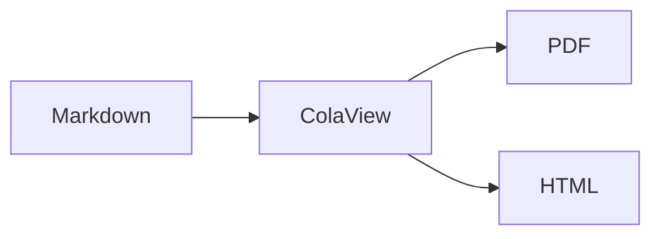

# ColaView MD

[](https://code.visualstudio.com/)
[](https://www.typescriptlang.org/)
[](LICENSE)
[](package.json)

VS Code 富文本 Markdown 预览与 PDF/HTML/Word 导出扩展 — 基于 [ColaMD](https://github.com/byteuser1977/ColaMD-extend) 渲染引擎（CodeMirror 6 内核）。

## 功能特性

- **所见即所得预览** — CodeMirror 6 驱动的只读编辑器，实时渲染 Markdown 富文本。源码缓冲区是唯一真相，导出零序列化损耗
- **数学公式** — KaTeX 集成，支持行内 `$...$` 和块级 `$$...$$` 公式（字体通过 base64 内联）
- **Mermaid 图表** — 17+ 种图表：流程图、时序图、类图、状态图、ER 图、甘特图、思维导图等
- **PDF 导出** — Puppeteer 无头 Chrome 生成 A4 PDF，完整保留主题样式
- **HTML 导出** — 独立 `.html` 文件，内嵌 CSS 和字体，零依赖分享
- **Word 导出** — 高保真 `.docx`，支持标题、列表、表格、图片、代码块、脚注，及 KaTeX/Mermaid 转图
- **导出保留主题样式** — PDF/HTML/Word 导出继承当前预览主题的字体、强调色、表格样式和引用块内边距
- **12 套内置主题** — Light、Dark、Elegant、Sepia、Notion、Bear、Writer、Solarized Dark、Nord、Gruvbox、Dracula、Midnight
- **自定义主题目录** — 在工作区根目录 `.themes/` 文件夹中放入 `.css` 文件即可自动识别
- **右键上下文菜单** — 预览面板内直接导出 HTML/PDF、切换主题（含子菜单）、导入自定义主题
- **实时同步** — 编辑后 150ms 防抖更新，实验性编辑器/预览滚动同步
- **源码保真** — 原始 Markdown 字节原样保留；导出直接使用缓冲区内容，无序列化损耗

## 快速开始

1. 安装扩展
2. 在 VS Code 中打开 `.md` 文件
3. `Ctrl+Shift+P` → **"ColaView MD: Show Preview"**
4. 侧边栏打开富文本预览

## 命令与使用方式

### 命令面板 (`Ctrl+Shift+P`)

| 命令 | 说明 |
|------|------|
| `ColaView MD: Show Preview` | 打开或聚焦预览面板 |
| `ColaView MD: Export to PDF...` | 导出为 A4 PDF |
| `ColaView MD: Export to HTML...` | 导出为独立 HTML |
| `ColaView MD: Export to Word...` | 导出为 `.docx` Word 文档 |
| `ColaView MD: Switch Preview Theme...` | 切换主题：12 套内置 + 自定义 |
| `ColaView MD: Import Custom Theme...` | 导入 `.css` 自定义主题 |

### 右键上下文菜单（预览面板内）

预览面板打开后，任意位置右键可访问：

| 菜单项 | 说明 |
|--------|------|
| **Export HTML** | 将当前预览导出为独立 HTML |
| **Export PDF** | 将当前预览导出为 A4 PDF |
| **Export Word** | 将当前预览导出为 `.docx` Word 文档 |
| **Theme ▸** | 子菜单列出所有内置 + 自定义主题（✓ 标记当前激活） |
| **Import Theme...** | 打开文件选择器导入 `.css` 文件 |

## 主题

### 内置主题

| 主题 | 风格 | 适用场景 |
|------|------|----------|
| **Light** | 干净白底，蓝色调 | 通用、文档 |
| **Dark** | GitHub Dark 配色 | 夜间编程 |
| **Elegant** | 暖色衬线，米色基调 | 学术论文、长文 |
| **Sepia** | 暖褐色调，纸质质感 | 长时间阅读、护眼 |
| **Notion** | Not.so MCP 风格 | 类 Notion 极简风 |
| **Bear** | Bear.app 笔记风格 | 笔记、随笔 |
| **Writer** | 等宽友好 | 技术文档、含代码多的文档 |
| **Solarized Dark** | Ethan Schoonover 调色板 | 低对比深色编码 |
| **Nord** | 北极蓝调色板 | 沉静专注写作 |
| **Gruvbox** | 复古 80 年代终端风 | 怀旧、高对比 |
| **Dracula** | Zeno Rocha 调色板 | 活力深色主题 |
| **Midnight** | 深蓝 + 金色点缀 | 夜间写作、高级感 |

### 自定义主题

在工作区根目录的 `.themes/` 目录下放置 `.css` 文件。扩展内置了 2 套自定义主题：

| 主题 | 风格 | 适用场景 |
|------|------|----------|
| **Academic Paper（学术论文）** | GB/T 7713 标准，衬线正文，三线表，纯黑白 | 学术论文、正式文档、打印 |
| **Trae Blue** | Trae IDE 文档风格，白底 slate 灰字，蓝色点缀 | 技术文档、现代文档编写 |

```
my-project/
├── .themes/
│   ├── my-dark.css        # 在主题菜单中显示为 "My-dark"
│   └── corporate.css      # 在主题菜单中显示为 "Corporate"
└── README.md
```

自定义主题会被自动检测，与内置主题一起出现在命令面板和右键菜单的主题列表中。

通过命令面板或设置切换：

```json
{ "colaview.theme": "nord" }
```

导入自定义 CSS：`Ctrl+Shift+P` → "ColaView MD: Import Custom Theme..." 或右键菜单 → "Import Theme..."

## 配置项

| 配置 | 类型 | 默认值 | 说明 |
|------|------|--------|------|
| `colaview.theme` | `string` | `"elegant"` | 预览主题：`light`、`dark`、`elegant`、`sepia`、`notion`、`bear`、`writer`、`solarized-dark`、`nord`、`gruvbox`、`dracula`、`midnight` 或任意自定义主题名 |
| `colaview.plugins.math` | `boolean` | `true` | *(已废弃，v0.3.0 起默认启用)* KaTeX 已内置于 ColaMD 引擎，无法单独关闭 |
| `colaview.plugins.mermaid` | `boolean` | `true` | *(已废弃，v0.3.0 起默认启用)* Mermaid 已内置于 ColaMD 引擎，无法单独关闭 |
| `colaview.pdfMethod` | `string` | `"puppeteer"` | PDF 引擎：`puppeteer` 或 `webviewPrint` |
| `colaview.autoPreview` | `boolean` | `false` | 打开 `.md` 文件时自动显示预览 |
| `colaview.customThemesPath` | `string` | `""` | 自定义主题 CSS 目录路径 |
| `colaview.scrollSync` | `boolean` | `false` | **实验性功能** — 启用编辑器与预览面板的滚动同步 |

> **关于插件开关：** v0.3.0 起，数学公式和 Mermaid 图表是 CodeMirror 6 版 ColaMD 引擎的内置功能，始终启用。`colaview.plugins.math` 和 `colaview.plugins.mermaid` 配置项为向后兼容保留，但已不再生效。

## 支持的语法

**标准 Markdown** — 标题、粗体、斜体、删除线、代码块、链接、图片、列表、引用

**GFM 扩展** — 表格、任务列表、脚注、自动链接

**数学公式（KaTeX）**

```markdown
行内：$E = mc^2$

块级：
$$\int_{-\infty}^{\infty} e^{-x^2} dx = \sqrt{\pi}$$
```

**图表（Mermaid）**

````markdown

````

支持：流程图、时序图、类图、状态图、ER 图、用户旅程、饼图、甘特图、Git 图、思维导图、时间线、四象限图、XY 图、C4 架构图、Sankey 图、Block 图、架构图

## 技术架构

```
┌─────────────┐     postMessage      ┌──────────────────┐
│  Extension   │ ◄──────────────────► │    WebView        │
│  (Node.js)   │                      │  (CodeMirror 6/  │
│              │   raw markdown ──►   │   ColaMD 渲染器)  │
│  ThemeManager│   theme/css ──►      │                   │
│  Exporters   │   ◄── 完整 HTML      │  只读富文本预览    │
│              │                      │  + 右键上下文菜单   │
└─────────────┘                      └──────────────────┘
```

**核心设计：** 扩展端将原始 Markdown 发送到 WebView，由 ColaMD（CodeMirror 6 内核）渲染为只读富文本预览。源码缓冲区是唯一真相，导出时直接使用缓冲区内容，零序列化损耗。导出时，WebView 异步构建完整独立 HTML（含 KaTeX 字体、Mermaid SVG、主题 CSS），返回给扩展端。

### 安全模型

WebView 采用严格的内容安全策略（CSP）：

1. `style-src 'unsafe-inline'` — CodeMirror 6 动态样式和 KaTeX 内联字体需要
2. `script-src 'unsafe-inline'` — esbuild IIFE 打包格式需要
3. 所有资源 URI 通过 `webview.asWebviewUri()` 解析，实现沙箱隔离
4. 即使 Markdown 内容包含恶意脚本也能防止 XSS 注入

### 项目结构

```
src/
├── extension.ts              # 入口（activate/deactivate），错误隔离
├── commands/commands.ts      # 命令注册（showPreview, exportHTML, exportPDF 等）
├── preview/
│   ├── preview-manager.ts    # WebView 生命周期、消息处理、防抖同步
│   └── webview/
│       ├── index.html        # WebView 模板 + 右键菜单样式
│       └── app.ts            # ColaMD (CM6) 初始化 + 右键菜单 + 滚动同步
├── export/
│   ├── pdf-exporter.ts       # Puppeteer PDF 生成（A4、保留背景）
│   ├── html-exporter.ts      # 独立 HTML 导出（内嵌 CSS）
│   ├── docx-exporter.ts      # Word (.docx) 导出（docx + remark-parse/remark-gfm）
│   ├── render-export-images.ts # KaTeX/Mermaid → PNG（无头 Chrome）用于 Word 导出
│   └── theme-style.ts        # 主题 CSS → 语义化 HTML 样式转换器（供导出使用）
├── themes/
│   ├── theme-manager.ts      # 主题加载、切换、.themes/ 目录扫描、导入
│   ├── foundation.css        # 基础 CSS 变量层（颜色、间距）
│   └── built-in/             # 12 套内置主题（light.css, dark.css, elegant.css, sepia.css, ...）
└── types/
    └── colamd-renderer.d.ts  # ColaMD 2.7.9 npm 包本地类型声明
```

## 开发

```bash
git clone https://github.com/bytechain/vscode-colaview.git
cd vscode-colaview
npm install

# 构建（esbuild 将所有依赖打包到 out/）
npm run build

# 监听模式
npm run watch

# 打包 .vsix
npm run package

# 调试：在 VS Code 中按 F5 启动扩展开发宿主
```

### 构建系统

项目使用 **esbuild** 打包 — 扩展端（`out/extension.js`）是一个仅依赖 VS Code API 的小型 CJS bundle。WebView 端（`out/preview/webview/app.js`）是包含完整 ColaMD 2.7.9 渲染引擎（CodeMirror 6 + Mermaid + KaTeX）的 IIFE bundle — 未压缩约 3.4MB，gzip 后约 400KB。构建时自动复制资源文件（CSS、WebView HTML、KaTeX 样式表、Mermaid 脚本）到 `out/` 目录，确保打包安装后功能正常。

## 更新日志

### v0.3.0（当前版本）

- **📝 Word 导出（`.docx`）** — 从 ColaMD-extend 移植。高保真 Word 导出，支持标题、段落、行内样式、代码块、列表、表格、引用块、水平线、图片、脚注，以及 KaTeX/Mermaid 转图。
- **🎨 导出保留主题样式** — 新增 `theme-style.ts` 转换模块，将编辑器专属选择器（`#editor .cm-content .cm-md-*`）映射为语义化 HTML 选择器，PDF/HTML/Word 导出继承当前预览主题的字体、强调色、表格表头样式和引用块内边距。
- **🐛 修复 PDF 导出空白** — 剥离 ColaMD 的 Electron `@media print` 规则（该规则会隐藏导出的 `<article>` 元素），PDF（和 HTML）导出不再空白。
- **🐛 修复 HTML 导出主题样式失效** — 修复导出 HTML 因编辑器专属选择器无法匹配而丢失主题样式的问题。
- **📦 新增依赖** — `docx`、`katex`、`remark-parse`、`remark-gfm`、`unified`。
- **🔧 引擎升级 — ColaMD 2.7.9（CodeMirror 6）** — 从 Milkdown/ProseMirror 迁移到 CodeMirror 6。源码缓冲区成为唯一真相，导出零序列化损耗
- **🎨 12 套内置主题** — 从 4 套扩展到 12 套：Light、Dark、Elegant、Sepia、Notion、Bear、Writer、Solarized Dark、Nord、Gruvbox、Dracula、Midnight。默认主题改为 Elegant
- **📤 异步 HTML 导出** — `buildExportHTML()` 变为异步，自动等待 Mermaid 图表和 KaTeX 字体渲染完成后再产出最终 HTML
- **🗑️ 移除插件开关** — 数学公式和 Mermaid 已内置于 ColaMD 引擎；`colaview.plugins.math` 和 `colaview.plugins.mermaid` 配置项不再生效
- **📰 移除 Newsprint 主题** — Newsprint 在 ColaMD 2.7.9 中不存在
- **🔄 DOM 结构变更** — 预览容器使用 `.cm-editor` / `.cm-scroller` / `.cm-content` 替代 `.ProseMirror`。滚动同步目标更新为 `.cm-scroller`
- **📦 依赖升级** — `@bytechain.cn/colamd` 从 `^1.5.2` 升级到 `^2.7.9`。2.7.9 npm 包未发布 `.d.ts` 文件，本地补充类型声明
- **🖼️ KaTeX 字体内联** — KaTeX 字体 base64 编码在 `colamd.css` 中，PDF 导出无需额外资源路径

### v0.2.0

- **🏗️ 架构重构** — 激活流程错误隔离、PreviewManager 重构、math/mermaid 设置变更自动实时同步
- **🖱️ 右键上下文菜单** — 预览面板内直接导出 HTML/PDF、切换主题（含子菜单）、导入自定义主题
- **🎨 新增自定义主题** — 学术论文 Academic Paper（GB/T 7713 标准）和 Trae Blue（Trae IDE 文档风格）
- **🧹 代码清理** — 移除废弃文件（`debug-load.js`、`configuration.ts`、`file-utils.ts`）
- **🐛 问题修复** — h4 标题颜色一致性、代码块边框颜色、打印页边距宽度

### v0.1.3

- **🔄 实验性滚动同步** — 编辑器与预览面板双向滚动同步。通过 `colaview.scrollSync` 设置启用。
- 增强扩展激活和预览管理器初始化时的错误处理

### v0.1.2

- **🐛 引用块背景色修复** — 修复 Dark、Light、Newsprint 主题下 blockquote 背景色被页面背景色覆盖的问题

### v0.1.1

- **🎨 主题一致性修复** — 统一 4 套内置主题（Light、Dark、Elegant、Newsprint）的 `--code-color` 和 `--code-block-text` CSS 变量，解决行内代码与代码块字体颜色不一致的问题
- **📰 Newsprint 主题对齐** — Newsprint 主题变量完全对齐 [ColaMD-extend](https://github.com/byteuser1977/ColaMD-extend) base.css，包括衬线字体（PT Serif 字体栈）、代码颜色继承及全部语义化颜色 token
- **🔧 Light 主题补全** — 补充 Light 主题缺失的 `--table-border` 变量，确保表格样式一致
- **📦 依赖迁移** — 从本地 ColaMD 项目引用切换为 npm 包 `@bytechain.cn/colamd` (^1.5.2)

### v0.1.0

- 首次发布，包含所见即所得预览、PDF/HTML 导出、4 套内置主题、自定义主题支持

## 许可证

[MIT](LICENSE)
